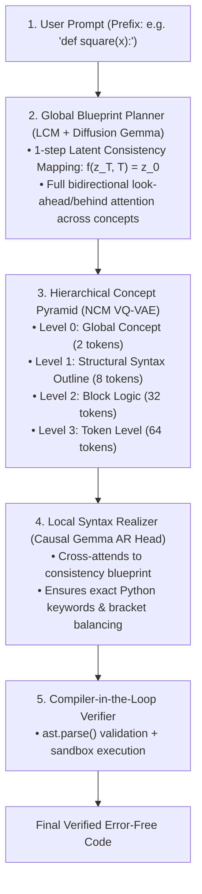

# 🤖 Code Robot: Next-Concept Modeling (NCM) & Hybrid Consistency Model (HC-NCM)

A state-of-the-art neural code generator designed for **parallel, coarse-to-fine hierarchical code synthesis** with **sub-120ms latency**.

Inspired by Stanford Hazy Research ([arXiv:2610.14162](https://arxiv.org/abs/2610.14162)), Latent Consistency Models (LCM), and bidirectional diffusion backbones (Diffusion Gemma).

---

## ⚡ The Architectural Breakthrough: Why Hybrid?

| Architecture | Mechanism | Steps for 64 Tokens | Latency / FLOPs | Syntactic Quality |
| :--- | :--- | :--- | :--- | :--- |
| **Autoregressive LLM** *(Gemma/GPT)* | Sequential causal decoding (left-to-right) | 64 forward evaluations | High (Memory bandwidth bound) | **High** (Causal syntax guarantee) |
| **Discrete Text Diffusion** *(Diffusion Gemma)* | Reverse denoising over entire sequence | 32 - 64 forward evaluations | High (Full $L \times L$ recomputed) | **Low** (Coordination failures / hallucinated syntax) |
| **Next-Concept Modeling** *(Stanford NCM)* | Multi-scale hierarchical pyramid ($2 \to 8 \to 32 \to 64$) | 4 forward evaluations | **16x faster** | **Good** |
| **HC-NCM (Our Hybrid Model)** | **1-Step LCM + Bidirectional + NCM + Causal AR** | **1 (LCM) + 4 (NCM) steps** | **Sub-120ms throughput** | **Very High** (Compiler/AST-verified) |

---

## 💡 How the Hybrid Consistency Pipeline Works



---

## 🚀 Model Parameter Tiers

Code Robot supports flexible model scaling from edge/CPU experimentation up to large multi-million parameter models:

| Model Tier | Total Params | VQ-VAE Concept Tokenizer | Generator / Backbone | Target Context / Prefix | Hierarchy Scales |
| :--- | :--- | :--- | :--- | :--- | :--- |
| **Small** (Baseline) | **~2.9M** | 974K (2 enc / 2 dec) | 1.95M ($d=128$, 4 layers, 4 heads) | 64 / 32 tokens | `[2, 8, 32, 64]` |
| **Medium** (Scaled) | **~19.3M** | 6.98M (4 enc / 4 dec) | 12.36M ($d=256$, 6 layers, 8 heads) | 128 / 64 tokens | `[4, 16, 64, 128]` |
| **Large** (Deep) | **~108.3M** | 40.32M (6 enc / 6 dec) | 67.95M ($d=512$, 8 layers, 8 heads) | 256 / 64 tokens | `[4, 16, 64, 256]` |
| **Hybrid (HC-NCM)** | **~3.6M** | 974K (VQ-VAE) | 1.95M (NCM) + 330K (LCM) + 325K (AR) | 64 / 32 tokens | 1-step LCM + 4-scale NCM |

---

## 🛠️ Usage & CLI Quickstart

### 1. View Model Parameter Tiers
```bash
python robot.py --tiers
```

### 2. Run the Full Hybrid Pipeline & Architectural Benchmark
```bash
python run_hybrid_pipeline.py
```

### 3. Generate Code with the Hybrid Consistency Engine
```bash
python robot.py --hybrid --prompt "# Return the square of x\ndef square(x):\n"
```

### 4. Interactive Teacher & Curriculum Console
```bash
python teach_robot.py --interactive
python teach_robot.py --chapter 1      # Chapter 1: Arithmetic
python teach_robot.py --all            # All 10 curriculum chapters
```

### 5. Developmental Nursery (Stage 1 Phonics)
```bash
python run_stage1.py
```

### 6. Autonomous Self-Training Loop
```bash
python run_self_training.py
```

---

## 📁 Repository Structure

```
robot/
├── custom_ncm/                 # Core engine package
│   ├── lcm_flow.py            # Latent Consistency Model (1-step solver & bidirectional backbone)
│   ├── hybrid_model.py        # Unified HC-NCM architecture (LCM + Gemma + NCM + AR)
│   ├── train_hybrid.py        # Hybrid training script
│   ├── config.py              # Parameter scaling configs (Small, Medium, Large)
│   ├── code_tokenizer.py      # Byte-level UTF-8 code tokenizer
│   ├── vqvae.py               # Multiscale Residual Vector Quantizer (Stage 1)
│   ├── ncm_model.py           # Next-Concept Transformer Generator (Stage 2)
│   ├── self_trainer.py        # Autonomous self-training engine
│   ├── stage1_nursery.py      # Developmental Stage 1 phonics training
│   ├── teacher.py             # Interactive curriculum teacher engine
│   ├── curriculum.py          # 10-chapter progressive Python curriculum
│   ├── verifier.py            # AST syntax & execution sandbox
│   └── official_python_harvester.py # Harvester for Python stdlib & docs
├── checkpoints/               # Trained models and checkpoints
│   ├── hybrid/hybrid_model.pt # Trained Hybrid Consistency Model
│   ├── generator_official_python.pt
│   └── vqvae_pos.pt
├── robot.py                   # Main CLI entry point
├── run_hybrid_pipeline.py     # End-to-end hybrid pipeline & benchmark runner
├── teach_robot.py             # Interactive curriculum CLI
├── run_stage1.py              # Stage 1 Nursery phonics runner
├── run_self_training.py       # Autonomous self-training runner
└── README.md
```

---

## 📜 License
MIT License.
